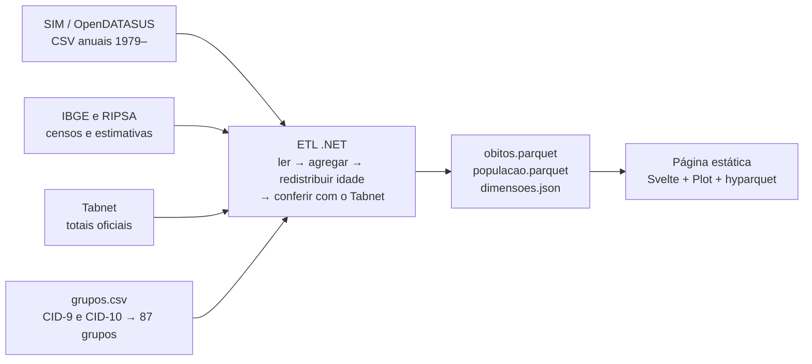
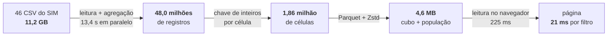
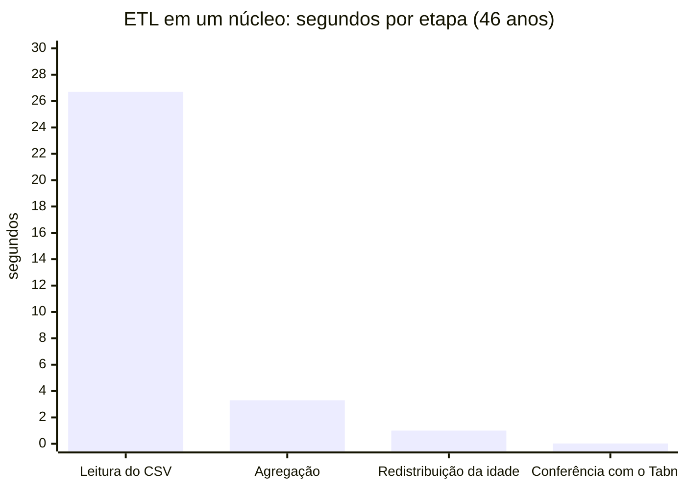
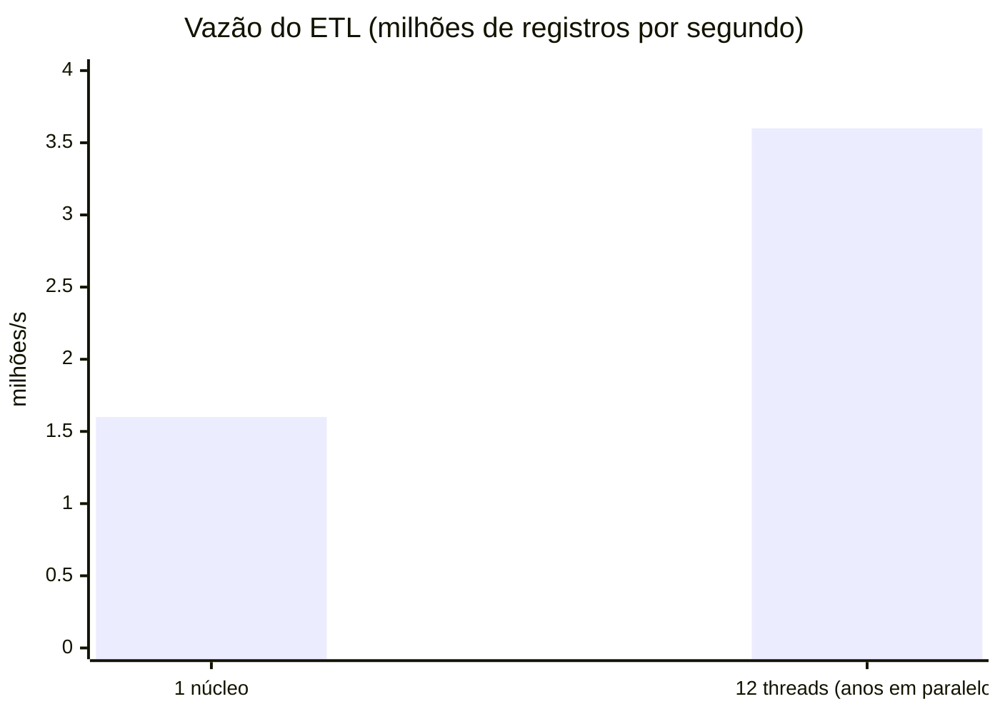
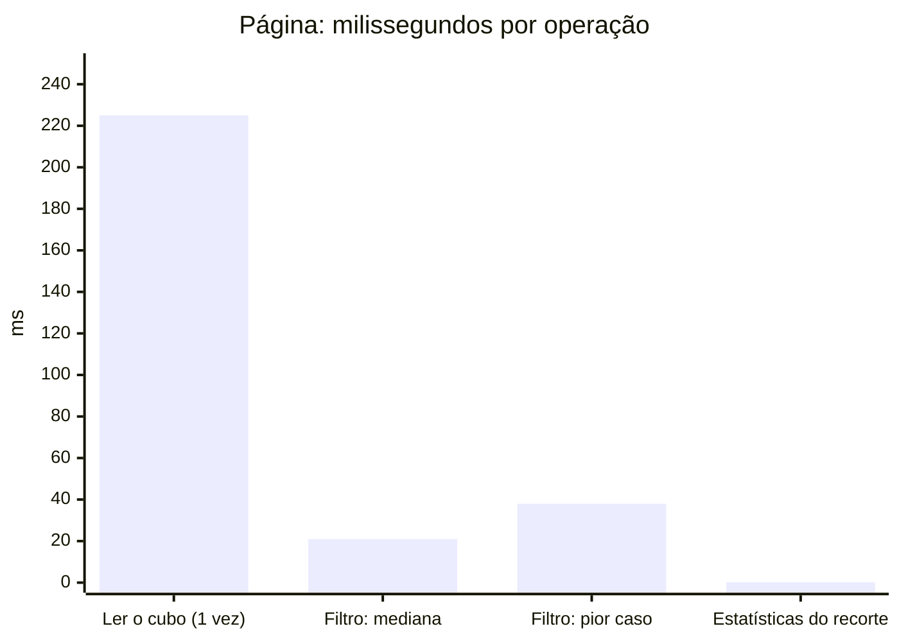

# Mortalidade no Brasil

[](https://github.com/LuisFelipeUnzueta/data_analisys_dotnet/actions/workflows/ci.yml)
[](https://github.com/LuisFelipeUnzueta/data_analisys_dotnet/actions/workflows/pages.yml)

**Página publicada: https://luisfelipeunzueta.github.io/data_analisys_dotnet/**

Página interativa com a mortalidade no Brasil desde 1979, por região e UF de residência, grupo de causa harmonizado entre a CID-9 e a CID-10, sexo e faixa etária, em óbitos, taxa bruta e taxa padronizada por idade. Um ETL em .NET lê os 46,4 milhões de registros do SIM, confere cada ano com o Tabnet do DATASUS e gera um cubo agregado em Parquet, que o navegador lê direto, sem servidor de aplicação.

## O que a página mostra

- **Filtros** de período, local (Brasil, região ou UF), causa, intervalo de idade, sexo e métrica, que valem para todas as visualizações e ficam na URL, então cada recorte vira um link compartilhável.
- **Série temporal** de 1979 ao último ano, com a marca da troca da CID-9 pela CID-10 em 1996, **intervalo de confiança de 95%** e a **tendência** do período (variação percentual anual).
- **Excesso de óbitos** nos anos depois do período escolhido, comparado com o esperado pela tendência desse período (por exemplo, base 2015–2019 para medir a covid).
- **Como ler as métricas e as estatísticas:** explicações com exemplos do recorte filtrado, incluindo um simulador de como o intervalo de confiança estreita com mais óbitos, a reta de tendência em escala normal ou logarítmica e os anos-base do excesso.
- **Mapa por UF** (malha do IBGE); clicar numa UF filtra a página.
- **Pirâmide etária** do ano final, por sexo.
- **Ranking das principais causas** no recorte; clicar numa causa filtra a página.
- **Causas mal definidas** por ano, como indicador da qualidade do registro.
- **Avisos metodológicos** que acompanham o recorte (comparabilidade em 1996, população estimada, Tocantins em 1989) e **tabela de dados** em cada gráfico.

## Como os números são produzidos



1. **Leitura.** Cada CSV anual do SIM é lido pelo nome das colunas, porque o layout muda 16 vezes entre 1979 e 2023 (nomes de CID-9 e CID-10, município com 7 ou 6 dígitos, colunas em minúsculas em 2023, zeros à esquerda perdidos em 2022–2023). Ficam só os óbitos não fetais.
2. **Harmonização.** A causa básica passa por [`data/cause_map/grupos.csv`](data/cause_map/grupos.csv), que leva cada código das duas revisões a um de 87 grupos. Cobre 100% dos 12.986 códigos observados.
3. **Agregação.** O cubo soma os óbitos por ano × UF de residência × grupo × sexo × faixa quinquenal até 80+, com sexo e idade ignorados como categorias visíveis.
4. **Conferência.** Cada ano é comparado com o Tabnet (total, por UF e por sexo) e só é publicado se a igualdade for exata. De 1979 a 2023, os 45 anos batem.
5. **Saída.** O cubo (1,8 milhão de linhas, 4,3 MB), a população e as dimensões são gravados em Parquet e JSON para a página.

## Metodologia

| Tema | Decisão |
|---|---|
| Série | Só anos que o Tabnet declara finais e que conferem exatamente. Hoje, 1979–2023: o CSV de 2024 tem 4.646 óbitos a menos que o Tabnet e entra quando for republicado. |
| Local | UF de **residência**. O antigo Território de Fernando de Noronha (código 20) conta como PE; residência inválida usa a UF de ocorrência. Tocantins aparece a partir de 1989; antes, o território está em Goiás. |
| Causas | 87 grupos com faixas CID-9 e CID-10 e um grupo "restante" por capítulo. Na troca de 1995 para 1996, 23 grupos variam mais de 10% além da tendência e levam aviso de comparabilidade reduzida. Causas mal definidas seguem o conceito do Tabnet e são um grupo próprio. |
| População | Censo 1980 (SIDRA), Censo 1991 e Contagem 1996 (Tabnet) e estimativas RIPSA 2024 a partir de 2000. 1981–1999 interpolados geometricamente; 1979 extrapolado de 1980–1981. |
| Taxas | Por 100 mil habitantes. A padronizada usa o método direto com a população-padrão da OMS 2000–2025; num intervalo de idade, só os pesos das faixas do intervalo. |
| Idade ignorada | Fica visível no cubo e é redistribuída na proporção das faixas conhecidas só para a taxa padronizada. |
| Intervalos de confiança | Taxa bruta: IC exato de Poisson. Taxa padronizada: método gama de Fay e Feuer (o do SEER). Quantis do qui-quadrado pela aproximação de Wilson–Hilferty. Estimativas com menos de 20 óbitos ou erro relativo acima de 30% são marcadas como instáveis. |
| Tendência | Variação percentual anual (APC) por regressão log-linear ponderada (pesos 1/Var(ln taxa)), com IC pela variância residual e quantil t. Não é calculada quando a maioria dos anos do recorte é instável. |
| Excesso de mortalidade | O período escolhido é a base: em cada faixa etária, regressão quasi-Poisson com tendência linear sobre esses anos (mínimo de 3) e a população como offset; o esperado é projetado para os anos seguintes. O IC soma a variância do esperado (com a dispersão φ) e a da projeção (método delta). |

O levantamento das fontes, do layout dos arquivos e das opções de população-padrão está em [`reports/Fontes e padrões da fase 0.md`](reports/Fontes%20e%20padrões%20da%20fase%200.md).

## Arquitetura

O ETL é um projeto único, [`src/Mortalidade.Etl`](src/Mortalidade.Etl), com o domínio isolado por namespace em vez de camadas em projetos separados: o problema é um batch sem domínio transacional, e a complexidade real está nos dados.

```
src/Mortalidade.Etl/
  Dominio/     regras puras: dimensões, MapaCausas, EstimativaPopulacional, RedistribuicaoIdade, Taxas
  Leitura/     todo arquivo de texto: SIM (pacote Sep), mapa de causas, gabarito, população e pesos da OMS
  Cubo/        AgregadorCubo, EscritorParquet (Parquet.Net), GeradorDimensoes
  Validacao/   ConferenciaTabnet e ContinuidadeCid
  Pipeline/    Entradas (carga encadeada com Result.Bind), ProcessadorAno, PublicacaoSaida e GeradorFixtures
  Program.cs   composição, anos em paralelo e relatório
web/           página Svelte 5 + Vite + Observable Plot + hyparquet
scripts/       consultas ao Tabnet e ao SIDRA (Python, só biblioteca padrão)
data/          tabela de causas, gabarito do Tabnet, população-fonte e pesos da OMS (versionados)
```

- **Sem servidor e sem interfaces especulativas.** O ETL lê arquivos locais e grava num diretório; download e publicação ficam nos workflows. Kafka, filas, CQRS e microsserviços ficaram de fora de propósito: os dados mudam no máximo uma vez por mês e cabem em arquivos estáticos.
- **Regra como dado.** A correspondência de causas, os pesos da OMS e o gabarito do Tabnet são CSV versionados, não código. O domínio recebe valores já tipados; interpretar arquivo é papel de `Leitura`.
- **Uma regra, um lugar.** As regras territoriais (Fernando de Noronha como PE, Tocantins separado de Goiás em 1989) ficam em `Uf`, e os marcos metodológicos vão no `dimensoes.json`, de onde a página tira linhas e avisos.
- **Desempenho.** Ver a seção abaixo, com as medições de cada etapa.

## Desempenho

Medido em um notebook Intel Core 7 150U (2 núcleos de desempenho + 8 de eficiência, 12 threads), 32 GB de RAM e SSD NVMe, com .NET 10 e Node 24, sobre os 46 CSV de 1979 a 2024. Os números saem de dois comandos reproduzíveis (ver [Medir](#medir)).

### Do CSV ao navegador



Cada etapa reduz o volume em ordens de grandeza: 11,2 GB de texto viram 4,6 MB, cerca de 2.400 vezes menos, e é isso que permite uma página sem servidor.

### ETL: onde o tempo vai

Tempo de cada etapa em um só núcleo, nos 46 anos:



- **A leitura domina (86%).** São 11,2 GB de texto. O pacote Sep lê os campos como spans, sem criar uma string por campo; o código de causa vira uma `CausaBasica` reaproveitada por um dicionário consultado pelo próprio span.
- **A agregação custa só 3,3 s para 48 milhões de registros (cerca de 70 ns por óbito).** A chave é uma tupla de inteiros (UF, índice do grupo, sexo, faixa), incrementada com uma única busca no dicionário, e o grupo de cada código fica em cache.
- **Redistribuição e conferência são desprezíveis**, porque trabalham sobre as 1,86 milhão de células e não sobre os registros.



Processar os anos em paralelo dá 2,3 vezes mais vazão: de 31,0 s para 13,4 s. O ganho não é de 12 vezes porque o processador de notebook tem só 2 núcleos de desempenho e a leitura de texto fica limitada pela memória. O pico de memória do processo foi de 326 MB, porque cada ano é lido em fluxo e só as células ficam na memória.

### Uma troca medida: tamanho do cubo × tempo de gravação

O perfil mostrou que gravar os Parquet levava mais tempo do que processar os 48 milhões de registros. A causa é o nível de compressão do Zstd:

| Nível do Zstd | Gravação | `obitos.parquet` | ETL completo |
|---|---|---|---|
| **Máximo (escolhido)** | 22,0 s | **4,28 MB** | 40 s |
| Optimal | 1,1 s | 5,57 MB (+30%) | 19 s |
| Fastest | 1,3 s | 5,73 MB (+34%) | 18 s |

O ETL roda uma vez por mês no GitHub Actions, e o cubo é baixado por cada visitante. Por isso o projeto mantém o nível máximo: 20 s a mais por mês economizam 1,3 MB em cada visita.

### Página: tempo de resposta



| Item | Valor |
|---|---|
| Download (cubo + população + dimensões) | 4,6 MB, uma vez |
| JavaScript da página | 528 KB (216 KB comprimido) |
| Leitura do cubo para arrays tipados | 225 ms |
| Agregação de um filtro (uma passada pelas 1,8 milhão de linhas) | 21 ms na mediana, 38 ms no pior caso, cerca de 180 milhões de linhas por segundo |
| Taxas, intervalos de confiança, tendência e excesso do recorte | 0,2 ms |

A página não guarda nenhum resultado pré-calculado por filtro: cada mudança refaz a agregação inteira em menos de 40 ms. O cubo fica em colunas tipadas (`Int16Array`, `Uint8Array`, `Float32Array`), sem um objeto por linha, e uma única passada alimenta as quatro visualizações.

### Medir

```bash
dotnet run -c Release --project src/Mortalidade.Etl -- perfil data/raw out/perfil.json   # ETL por etapa
MEDIR=1 npm --prefix web test -- desempenho                                               # página (grava out/perfil-web.json)
```

## Qualidade

- **114 testes no .NET**, entre eles:
  - golden files da harmonização: cobertura dos 12.986 códigos, totais por grupo de 1992–1999 e coerência da marca de comparabilidade com o salto de 1996;
  - os 16 layouts do CSV, a decodificação da idade e as regras de UF;
  - interpolação populacional, padronização e redistribuição de idade;
  - regra de arquitetura (NetArchTest): `Dominio` não depende de leitura, cubo, validação nem Parquet.
- **23 testes no front**, incluindo a conferência das taxas nacionais calculadas no navegador com as que o ETL grava no `dimensoes.json`, ano a ano, e as funções estatísticas: o IC de Fay e Feuer coincide com o de Poisson numa só faixa, a regressão recupera uma tendência exata e o modelo de excesso recupera um choque conhecido.
- **Conferência exata com o Tabnet** a cada execução do ETL.

## Executar localmente

Requer o SDK do .NET 10 (`global.json`), Node 24 e Python 3.

```bash
# dados de entrada: CSV anuais do SIM em data/raw/ (cerca de 12 GB descompactados)
curl -L -o data/raw/2023.zip https://s3.sa-east-1.amazonaws.com/ckan.saude.gov.br/SIM/csv/Mortalidade_Geral_2023_csv.zip

dotnet test
dotnet run -c Release --project src/Mortalidade.Etl -- data/raw out
cp out/* web/public/dados/

npm --prefix web install
npm --prefix web run dev      # http://localhost:5173
npm --prefix web test
```

O ETL processa os anos que estão no gabarito do Tabnet e sai com código 0 quando todos são publicados, 2 quando algum ano não confere (e fica de fora) e 1 em erro de entrada. Para atualizar as fontes oficiais:

```bash
python scripts/gerar_gabarito.py data/tabnet/gabarito.csv
python scripts/baixar_populacao.py data/ibge/populacao_fontes.csv 2024
```

Depois de mudar uma faixa do `grupos.csv`, regere as fixtures dos testes de harmonização e revise o diff do golden (anos que não conferem com o Tabnet ficam de fora):

```bash
dotnet run -c Release --project src/Mortalidade.Etl -- fixtures data/raw
```

## Atualização e publicação

- [`atualizacao.yml`](.github/workflows/atualizacao.yml) roda todo mês (e sob demanda): atualiza o gabarito e a população, baixa os CSV do SIM, roda o ETL e os testes e, se os dados mudaram, faz commit e republica a página.
- [`pages.yml`](.github/workflows/pages.yml) testa, gera o build da página e publica no GitHub Pages.
- [`ci.yml`](.github/workflows/ci.yml) compila e testa o .NET a cada push.

## Limitações

- A lista de grupos de causa ainda não passou pela revisão de alguém que trabalhe com codificação de causas de morte.
- A população de 1981–1999 é uma interpolação própria; entre 1996 e 2000 ela cresce cerca de 2,7% ao ano porque a âncora de 2000 é a estimativa RIPSA reconciliada, maior que o Censo 2000.
- A OMS publicou em 2026 uma nova população-padrão (2026–2050), não comparável com a atual; a migração está registrada como trabalho futuro.
